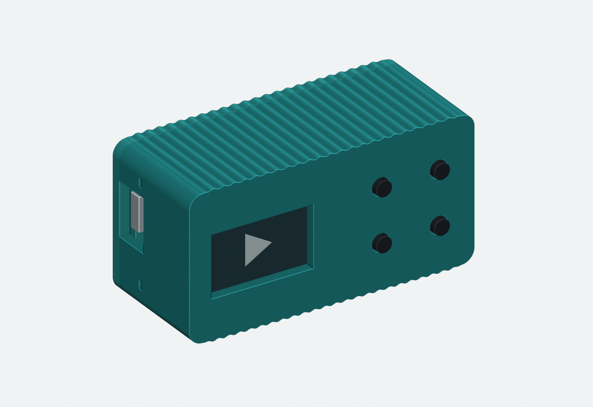

# Pico W YouTube Player

Raspberry Pi 5でYouTube動画を取得・縮小し、Wi-Fi接続のPico Wと0.96インチ液晶で再生する、小さな映像専用プレーヤーです。ブラウザーのダークUIからURL、再生区間、FPSを選びます。

動画全体を縦横比を保って160×80へ収め、余白は黒にします。JPEG連番を普通のフォルダーに保存し、送信する1枚ずつをPi5でRGB565へ展開します。保存済み動画は繰り返し再生し、通信が切れたら動画の経過位置から再接続します。



これはCADの設計画像です。ユーザーの実機ではv3ケースの印刷・組立、4ボタンの診断、動画の色・向き・画面の収まりを確認済みです。

## できることと現在の範囲

- YouTube動画1本のURL入力、全編または開始・終了時刻の指定。
- 6 / 12 / 18 / 24 / 30fpsへの変換、履歴からの再生、保存量の確認と確認付き削除。
- 取得・変換中も現在の動画を継続し、完成後に新しい動画の先頭へ切替。
- LCDの色補正、採用済みガンマ、ケースの向きに合わせた180度回転。
- 音声はありません。4ボタンは配線と単独診断まで実装済みで、本番の再生操作は未実装です。

指定FPSは変換・配信の目標です。Wi-Fiでは再送や停止が残り、安定した6fpsや24/30fpsの描画を保証していません。有線24fpsの安定動作、OS再起動後の復帰、24時間耐久は今後の確認項目です。以前の有線高FPS試験は別の配信経路であり、現在のJPEG保存方式の性能保証にはしません。

## 必要なもの

| 用途 | 構成 |
|---|---|
| 動画取得・Web・配信 | Raspberry Pi 5、Python 3、Pillow、yt-dlp、ffmpeg/ffprobe、Node.js |
| 表示 | Raspberry Pi Pico W（RP2040）、0.96インチ80×160 RGB IPS SPI液晶 |
| 液晶コントローラー | 使用個体の基板印字はST7735S。別製品では端子・オフセットを確認 |
| 操作部 | タクトスイッチ4個、配線材。診断はGPIOの内部プルアップを使用 |
| ケース | 採用済み[SLIM v3の4部品](hardware/case/README.md)、3Dプリンター |
| Picoビルド | Pico SDK、CMake、ARM GCC、makeまたはNinja。転送にはpicotoolまたはUF2ドライブ |

yt-dlpはブラウザーを使わず取得します。ChromeはWeb操作に使えますが、取得にChromeやCookieは必要ありません。ffmpeg/ffprobeはHTTPS対応が必要です。既存SDKを使用し、ROSの導入は不要です。

## 配線

採用した実機は **SPI0、DISPLAY_PROFILE=0** です。物理ピン番号とGPIO番号を混同しないでください。

| LCD端子 | Pico W GPIO・電源 | 物理ピン |
|---|---|---:|
| CS | GP17（GPIOでCSを制御） | 22 |
| SCL / SCK | GP18（SPI0 SCK） | 24 |
| SDA / MOSI | GP19（SPI0 TX） | 25 |
| DC | GP20 | 26 |
| RES | GP21 | 27 |
| VCC | 3V3 OUT | 36 |
| GND | GND | 38 |
| BLK | 使用個体では未接続で表示確認済み | — |

GP18/19はハードウェアSPI0の組合せで、GP17はそのCSnにも対応します。BLKの内部回路は未確定です。同じ解像度でも別モジュールの接続方法をそのまま使わず、購入した基板の仕様を確認してください。[配線図](docs/wiring.md)も参照できます。

| ボタン | GPIO | 物理ピン |
|---|---|---:|
| 1 | GP12 | 16 |
| 2 | GP13 | 17 |
| 3 | GP14 | 19 |
| 4 | GP15 | 20 |
| 共通 | GND | 18など |

ボタンのもう一方をGNDへ接続し、押すとLOWになります。[4ボタン診断](docs/diagnostics/BUTTONS_ROTATION.md)に図形と確認方法を記録しています。旧SPI1配線案はGP12/13を液晶に使うため、このボタン配線と共用できません。完成機は上表のSPI0配線を使います。

## ケースの印刷・組立

[hardware/case/README.md](hardware/case/README.md)から、STL、Blender、組立図、寸法資料へ進めます。

印刷は、一括配置の `00_all_parts_A1mini.stl` **1つ**、または本体・蓋・上下ボタン保持板の **4つ** を使います。両方を一緒に読み込むと部品が重複します。mm、100%で読み込み、本体の横幅64mmを確認してください。

LCD→スイッチ→ボタン保持板→Pico→蓋の順に組みます。LCDの挿入には横へ滑らせる経路があるため、詳しい組立図を先に確認してください。使用個体ではボタン保持板がきつめながら組立でき、ユーザーの判断で形状を変更せず採用しています。

## 最初の起動

詳しい依存確認、設定、転送、サービス登録は[製作・起動手順](docs/BUILD_AND_RUN.md)にまとめています。以下は本リポジトリを使う最短の流れです。

1. Pi5にPython/Pillowとyt-dlp、HTTPS対応ffmpeg/ffprobe、Nodeを用意する。
2. [Web設定例](web-config.example.json)を新しい `web-config.json` にコピーし、保存先、Pi5のLAN IP、ツールの実パスを編集する。
3. [Pico設定例](pico/config.example.h)を新しい `config.h` にコピーし、SSID/パスワード、Pi5の `SERVER_IP` と `SERVER_PORT` をローカルで入力する。
4. Picoの静的IPを自分のLANへ合わせてビルドし、対象Pico Wを手動BOOTSELで接続してUF2を転送する。
5. Pi5のWeb/TCP配信を起動し、ブラウザーからYouTube URLを指定する。

既に実設定がある場合は見本で上書きせず、その設定を保持します。`config.h`、`web-config.json`、保存動画、設定を含むUF2/ELFは公開しないでください。

標準ビルド例：

```bash
cd /home/tane/dev/PicoW/PicoW_Youtube_Player
PICO_SDK_PATH=/home/tane/pico/pico-sdk cmake -S . -B build \
  -DPICO_BOARD=pico_w -DCMAKE_BUILD_TYPE=Release -DDISPLAY_PROFILE=0 \
  -DPLAYER_LCD_GAMMA_LGFX=ON -DPLAYER_ROTATE_180=ON
cmake --build build --clean-first -j2
```

PicoのIP既定値は192.168.0.173/24、GW/DNSは192.168.0.1です。別のLANではCMakeの `PLAYER_STATIC_IP`、`PLAYER_GATEWAY`、`PLAYER_NETMASK`、`PLAYER_DNS` を変更します。Pi5のIPは `config.h` とWeb設定の両方へ合わせます。変更後はclean-firstで再ビルドします。

手動起動：

```bash
python3 -m server.web --config web-config.json
```

現在の試作では **http://192.168.0.120:16152/**、Pico向けTCPは **192.168.0.120:16151** です。固定IPにbindする設定なので、Pi5のChromeでもLAN IPを使います。localhostでアクセスしたい場合は、その用途に合うbind設定が必要です。ポート16150/8080は既存用途のため使いません。

登録済みのuserサービスを使う場合は二重起動せず、`systemctl --user status picow-player.service` で確認します。[サービスの操作と設定](docs/WEB_PLAYER.md)に詳細があります。

## 保存と通信

```text
YouTube → yt-dlp / ffmpeg → data/videos/<id>/converted/<key>/frame00000001.jpg …
                                          ↓ 配信する1枚だけPi5で展開
                              RGB565 + PWF2ヘッダー → TCP → Pico W → SPI → LCD
```

新規保存はJPEGフォルダーで、ZIPやRAW連番を新規生成しません。JPEGは画像ビューアーから確認できます。全体表示は縦横比を維持して黒余白を付け、上下左右を切り落としません。

通常Web配信は非圧縮RGB565を送ります。160×80で1枚25,600B、PWF2ヘッダー20Bを含めて25,620Bです。6fpsで153,720B/s、30fpsで768,600B/sとなり、TCP/Wi-Fiの付加分は別です。送信期限2秒は1回の送信待ちの上限で、画面停止の上限ではありません。

## 検証と資料

```bash
python3 -B -m unittest discover -s tests -v
```

49件のホスト試験で、変換・JPEGフォルダー・全体表示・TCP切替/再接続・ガンマ・ボタン診断・180度回転を確認しています。液晶の実発色、印刷公差、無線性能は実機確認と分けて記録しています。

| 資料 | 内容 |
|---|---|
| [製作・起動手順](docs/BUILD_AND_RUN.md) | 依存、設定、ビルド、UF2転送、最初の再生 |
| [Web操作・運用](docs/WEB_PLAYER.md) | URL/FPS/履歴/容量、保存方式、サービス、失敗時の挙動 |
| [ケースv3](hardware/case/README.md) | 印刷する4部品、組立図、Blender、取得元 |
| [プロジェクト配置](docs/PROJECT_LAYOUT.md) | ソース、テスト、設定、診断の場所 |
| [LCDの比較元写真](docs/diagnostics/LCD_GAMMA_AB.md#比較元画像) | 液晶へ送った写真と階調チャート |
| [ボタンと回転の実機記録](docs/diagnostics/BUTTONS_ROTATION.md) | 図形テスト、配線、確認済みの表示方向 |
| [開発記録](docs/history/DEVELOPMENT_LOG.md) | 従来READMEの全測定・調査記録、採用前の案 |
| [通信診断](docs/diagnostics/CYW43_CREDIT_TEST.md) | TCP停滞とCYW43の調査、測定の限界 |
| [有線比較](docs/diagnostics/WIRED_ETH0_PREP.md) | 別経路の高FPS試験と一時設定の記録 |

## ライセンス

本プロジェクトは[MIT License](LICENSE)、Copyright (c) 2026 Tane Channel Technologyです。第三者のコード・データは各々の元ライセンスに従います。[THIRD_PARTY_NOTICES.md](THIRD_PARTY_NOTICES.md)と同梱ライセンスを保持してください。
