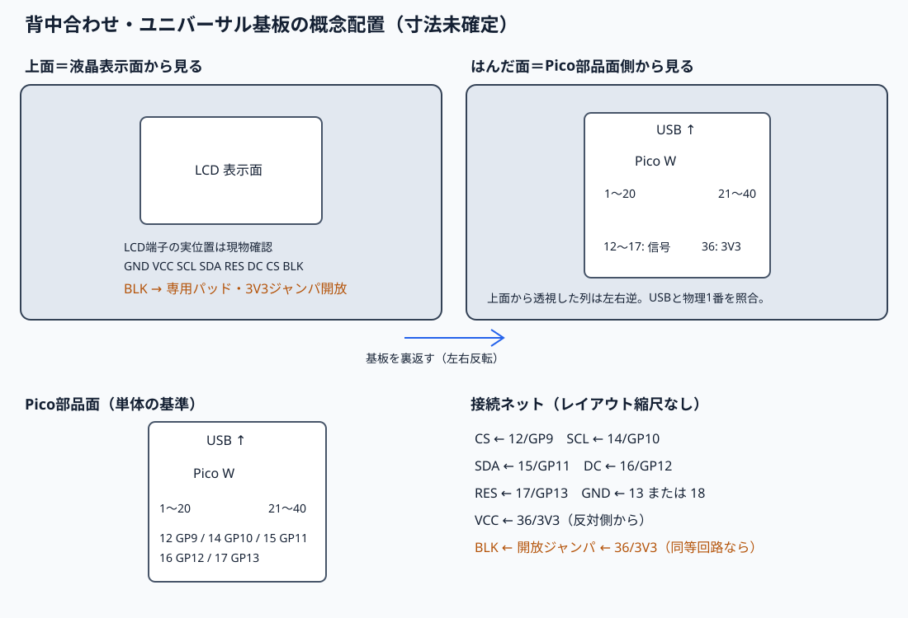

# 旧SPI1配置案（未採用）

> これは採用前の概念案です。最終v3ケースの実機はSPI0 GP17〜21と4ボタンGP12〜15を使用します。下のSPI1案はGP12/13がボタンと競合するため、現行の組立用配線として使わないでください。現在の[配線](../README.md#配線)と[ケース](../hardware/case/README.md)を参照してください。

これは既存ブレッドボード配線とは別の、完成形候補です。実物のLCD外形、端子列位置、取付穴、Pico Wとの干渉、アンテナ周囲の空間は未実測であり、図の寸法や位置は加工用データではありません。**配線変更は行っていません。**

| LCD端子 | Pico W 物理ピン | GPIO/電源 | 完成形案 |
|---|---:|---|---|
| SCL | 14 | GP10 | SPI1 SCK |
| SDA | 15 | GP11 | SPI1 TX (MOSI) |
| CS | 12 | GP9 | SPI1 CSn相当、ソフトウェア制御 |
| DC | 16 | GP12 | GPIO出力 |
| RES | 17 | GP13 | GPIO出力 |
| GND | 13または18 | GND | 同じ側の近いGND |
| VCC | 36 | 3V3(OUT) | 唯一の反対側からの電源配線 |
| BLK | 36からの3V3分岐 **候補** | GPIO未割当 | MSP0961と同等回路の場合の常時点灯案。現時点でジャンパ開放 |

Pico Wの[公式ピン配置図](https://datasheets.raspberrypi.com/picow/PicoW-A4-Pinout.pdf)を基に物理ピンを選びました。GP10/11はSPI1 SCK/TX、GP9はSPI1 CSnが可能です。試作用ファームウェアは `DISPLAY_PROFILE=0`、完成形候補は `DISPLAY_PROFILE=1` です。切替はソフト上の別設定で、現在の配線を変更しません。

## 向きと誤配線防止

- **液晶表示面:** 画面を正面から見る側。LCD端子の実際の左右位置は未確認です。現物のシルク印字 `GND VCC SCL SDA RES DC CS BLK` を各ランドで照合します。
- **Pico部品面:** USB端子を上、Pico Wの部品と印字が読める向きで見る側。物理1〜20番列は左、21〜40番列は右です。
- **ユニバーサル基板の上面:** この案では液晶表示面側を上面と呼びます。液晶をこの側に配置します。
- **ユニバーサル基板のはんだ面:** Pico部品面側から見る面です。USBを上に向けて見ると物理1〜20番列は左です。上面から透かして見た同じ列は右になるため、上面の図をそのままはんだ面へ写さないでください。配線前にUSB端子と物理1番を現物で再確認します。

## BLKについて

BLKは現在未接続です。[LCDWIKIのMSP0961製品資料](https://www.lcdwiki.com/0.96inch_IPS_Module)は同じ解像度・8端子順で、BLKをHighで点灯、調光不要なら3.3 V接続と記載しています。[同機種の回路図](https://www.lcdwiki.com/res/MSP0961/0.96inch_IPS_Schematic.pdf)にはBLKから1 kΩを介するS8050制御回路が描かれています。裏面写真の `DRIVER IC: ST7735S` 印字、U2とR1/R2/R3/C1の実装はこの構成と整合しますが、**実物のBLK→抵抗→U2の全経路は写真から追えず、MSP0961と同一機種とは確定できません**。図には物理36の3V3からBLKへ至る条件付きジャンパを示し、現時点では**開放**とします。これは同等回路なら常時点灯にする案で、**このBLK候補配線での通電・電流は未測定**です。GPIO直結は提案しません。次段階で基板仕様を照合して通電・点灯確認します。

## 現試作と製作前確認

現在の試作はGP17〜21/SPI0（`DISPLAY_PROFILE=0`）で、動画・全画面表示・採用ガンマの改善をユーザーが確認済みです。この図はGP9〜13/SPI1（`DISPLAY_PROFILE=1`）へ変更する別配線案です。新しい配線を採用する際は同じガンマONでprofile1をビルドしてPicoへ転送する必要があります。今回の確認・コミットでは新配線への変更や転送はしていません。

図の1100×750は描画キャンバスで、基板寸法のmm値ではありません。LCD外形/端子ピッチ/穴/高さ、Picoとの重なり・USBアクセス、アンテナ周囲の空間は未実測です。ランド単位の配線経路も未確定です。表裏で左右が逆になるため、USB端子・物理1番・LCDランドのシルク印字を現物と照合してください。

BLK未接続の現試作で液晶は表示しています。BLKへ3V3を加える案は、同型回路が確認できた場合の条件付き案のままです。GPIO割当/PWM調光は実装していません。BLKをVCCやGPIOへ接続する製作確定図としては扱わないでください。
