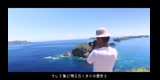

# LCDガンマ E0/E1 一組の比較とWeb復帰

2026-10-08 JST。実画面の収まりはユーザー確認済み。暗い色合い・鮮明度への比較用Bを準備し、その後のユーザー承認で同一Picoへ転送した。明るい写真・暗い写真・階調チャートの受信/描画を確認後、通常Web動画へ復帰済み。**ガンマが原因とは未確定**。変更はE0/E1のガンマ表一組だけで、元画像の明度・彩度は変えていない。

## 現在のファームとの対応

現在の復元/転送記録 [wifi-restore-result.json](../../diagnostics/results/wifi-restore-result.json) と [CYW43診断記録](CYW43_CREDIT_TEST.md) にあるSHA256は `7be46fb51d43beb4c4cd095c9b309c7c16f5b0e95a4b00d8ab698b7022b81380`。手元の `/tmp/picow_web_build_diag/pico_w_jpeg_player.uf2` と一致した。これを復帰用 `A-current-exact.uf2` として保全した。

比較オプション追加後に同じRelease/SPI0/CYW43診断ONで新規ビルドした **A（ガンマOFF）も、現行UF2と全バイト一致**。従って、古い通信テストの通常版や別IP版を基準にした比較ではない。稼働ログはPWS4のCYW43項目、MAC `28:cd:c1:09:78:41`、`raw-display`、PM読戻しmode0を確認。準備時は実転送記録・ファイル一致・稼働プロトコルで照合した。実機転送前にはBOOTSEL中の実Flashを復帰用Aで `picotool verify` し、完全一致を確認した。

SDKは `/home/tane/pico/pico-sdk`、SHA `9a4113fbbae65ee82d8cd6537963bc3d3b14bcca`。内包driver SHA `c1075d4bc440422cf2b2fd12c64a1f53f77660ee`。A/Bとも同じ既存の隔離CYW43診断driverを使い、共有SDKを編集しない。

## 変更は E0/E1 の二表だけ

比較準備時の `PLAYER_LCD_GAMMA_LGFX` の既定はOFF、BだけONだった。ユーザーの目視改善確認後、通常ビルドの既定を**ON**へ変更した。Aの再現はOFFを明示する。既存の `SWRESET → SLPOUT → COLMOD 05 → MADCTL 60 → INVON → DISPON` の、INVONとDISPONの間へ次の一組を追加する。

```text
E0: 02 1C 07 12 37 32 29 2D 29 25 2B 39 00 01 03 10
E1: 03 1D 07 06 2E 2C 29 2D 2E 2E 37 3F 00 00 02 10
```

各16B。正負を一組として扱い、片側だけ試さない。出典はローカル旧依存 `/home/tane/pico/LovyanGFX/src/lgfx/v1/panel/Panel_ST7735.hpp` の `Panel_ST7735S::Rcmd2`。現物ファイルSHA256 `6a4ed16c276a1c8db182eb5eb22942b2205ba7b42d46567a3399c2d1f0e84e69`。旧依存はコミット固定ではないため、この現物のデータを比較用に固定した。

旧ライブラリの電源/VCOM、B1/B2/B3/B4、NORON、追加待ち時間、COLMOD55、INVOFF、MADCTL6Cは移さない。SPI0 GP18/19・CS17、20MHz、X/Yオフセット0/24、MADCTL60、INVON、受信/表示バッファ、Wi-Fi設定/PM、TCP/PWF2/PWS4は同じ。Pi側の反転＋R/B交換補正・画像縮小/黒余白も変えない。Bは追加34BのLCDコマンド/データを起動時に送るだけで、定常通信やフレームの画素を書き換えない。

ソース: [診断ガンマ表](../../pico/lcd_gamma_lgfx.h)、[LCD初期化](../../pico/pico_player.c)、[切替オプション](../../CMakeLists.txt)。追加ブロックを取り除いたPicoソースは変更前と完全一致。実際の`lcd_init()`をホストCで実行し、Aの全初期化呼出しとBの差が上のE0/E1だけであることを確認した。

## 成果物と保全

保存先 `diagnostics/artifacts/lcd-gamma-ab/firmware/`。

| 名前 | 用途 | UF2サイズ | SHA256 |
|---|---|---:|---|
| `A-current-exact.uf2` | 転送記録に一致する現行・復帰用 | 641,536B | `7be46fb51d43beb4c4cd095c9b309c7c16f5b0e95a4b00d8ab698b7022b81380` |
| `A-gamma-off-rebuilt.uf2` | オプションOFFで再ビルドした同一基準 | 641,536B | `7be46fb51d43beb4c4cd095c9b309c7c16f5b0e95a4b00d8ab698b7022b81380` |
| `B-lgfx-e0e1-only.uf2` | E0/E1だけ追加した転送済み比較版 | 641,536B | `ee4cfe411d542618a188142c5246208e2e36af7d68cae5fe955b951567b6c1fb` |

ELFもそれぞれ保全し、JSON manifestにビルド設定・SHA256・サイズ・ソースのハッシュを保存する。既存のconfig.hをコンパイルするため、UF2/ELFにはWi-Fi設定が含まれる。成果物フォルダはmode700、各ファームはmode600、`diagnostics/artifacts/` をGit除外にした。資格情報の値は読んだり表示したりしていない。これらのファームを公開資料へ添付しない。

ビルドディレクトリは `/tmp/picow_gamma_ab_A` と `/tmp/picow_gamma_ab_B`。CPU優先度nice10、並列2で順番にビルドした。A/Bとも警告・エラーなし。text/BSSはmanifest参照。準備段階ではPicoへ書き込まず、後述の承認後に保全済みBを転送した。

## 同じ静止画像を通常の転送経路で比較する

[調査レポート](/home/tane/Documents/Codex/2026-10-08/task/color-investigation/ogasawara-report.md) の元画像をコピーして固定した。保存先 `diagnostics/artifacts/lcd-gamma-ab/assets/`。

- `photo_bright_0600.jpg`: 小笠原動画の空・海、元JPEGそのまま。
- `photo_dark_1400.jpg`: 暗い水中、元JPEGそのまま。
- `gray_rgb_reference.png`: 灰色10段（0/28/57/85/113/142/170/198/227/255）、連続灰色、R/G/B濃淡、中強度の色票。調査時のPNGそのまま。

全160×80。JPEG/PNGを書換え・再圧縮・再縮小しない。通常の本番関数 `image_rgb565(image, compensate_colors=True)` と `packet(..., mode="raw-display")` を使う。写真の結果は現在のWeb `FrameReader.read` と同じ。階調PNGはJPEG圧縮を挟まず、同じRGB565・色補正・PWF2経路へ送る。PicoのJPEGデコード経路は使わない。1フレームは25,600B、PWF2込み25,620B。A/Bで同じ画像のペイロードSHA256が同じことを `assets/references.json` で照合する。

[静止画像ツール](../../diagnostics/server/lcd_gamma_ab.py) は `--prepare-assets` ならファイル作成のみ。`--image` は明示的な比較用待受で、6fps・raw-display・補正ON・2秒送信期限を固定する。別の画像へ進むときにプロセスを終えて同じ設定で起動し直す。16151をWebが使用中ならbindが失敗し、Webを自動停止しない。

### 同じ画像でA/Bを評価する手順

1. 現在のWeb動画の選択キーとサービス状態を記録する。取得ジョブが動いていないことを確認する。親タスクで実機比較の承認を得てから、このアプリの配信だけを一時停止する。
2. **A現行のまま** 下のコマンドで明るい写真、暗い写真、灰色/RGBチャートを1枚ずつ保持する。カメラの露出・ホワイトバランス・距離・角度、LCDバックライトと室内光を固定する。写真にはA/画像名を外部記録する。起動時の3秒RGBパターンでは判断せず、この転送画像で比較する。
3. 将来の書込み承認後、同じPico Wの手動BOOTSEL、Flash ID `0xE661640843239D21` の照合、BのSHA確認、Verify付き書込みを行う。USBシリアルや自動BOOTSELは追加しない。同じ3画像を同じ順序・同じ送信設定でBとして撮影する。
4. 黒/白の端点、隣り合う灰色段の識別、中間調の明るさ、暗い水中の黒つぶれ、RGBの偏りをA/Bで比較する。LCDの見え方が改善したかを判定し、ソフトの理想復元画像を液晶の実測と扱わない。JPEGの輪郭・縮小条件・鮮鋭化はこの比較では変えない。
5. 必要なら保全したA現行UF2へ同一機・Verify付きで戻し、同じ写真とチャートを再度観察する。A→B→Aで撮影条件の変動も確認する。比較プロセスを終了して16151を空け、元のuserサービスと保存済み動画を再開し、Pico接続・描画を確認する。

固定画像送出例（実機比較では同じ引数を使用）:

```bash
cd /home/tane/dev/PicoW/PicoW_Youtube_Player
python3 -B -m diagnostics.server.lcd_gamma_ab \
  --host 192.168.0.120 --port 16151 \
  --image diagnostics/artifacts/lcd-gamma-ab/assets/photo_bright_0600.jpg
```

次の画像は`--image`だけを `photo_dark_1400.jpg`、`gray_rgb_reference.png`へ替える。A/Bでもこの引数と素材は同一。実機比較後はこの待受を停止し、通常Webへ復帰済み。

## 再ビルドとソフト検証

```bash
cd /home/tane/dev/PicoW/PicoW_Youtube_Player
PICO_SDK_PATH=/home/tane/pico/pico-sdk cmake -S . -B /tmp/picow_gamma_ab_A \
  -DPICO_BOARD=pico_w -DCMAKE_BUILD_TYPE=Release -DDISPLAY_PROFILE=0 \
  -DPLAYER_CYW43_DIAG=ON -DPLAYER_LCD_GAMMA_LGFX=OFF
cmake --build /tmp/picow_gamma_ab_A --clean-first -j2
# Bは別buildディレクトリ、同じ引数でGAMMAだけON:
PICO_SDK_PATH=/home/tane/pico/pico-sdk cmake -S . -B /tmp/picow_gamma_ab_B \
  -DPICO_BOARD=pico_w -DCMAKE_BUILD_TYPE=Release -DDISPLAY_PROFILE=0 \
  -DPLAYER_CYW43_DIAG=ON -DPLAYER_LCD_GAMMA_LGFX=ON
cmake --build /tmp/picow_gamma_ab_B --clean-first -j2
python3 -B -m unittest discover -s tests -v
```

既存42件＋比較2件の **44件成功（10.963秒）**。[テスト](../../tests/test_lcd_gamma.py) は実LCD初期化の呼出し差分、基準写真のバイト保持、Webと同じ色補正ペイロード、PNG階調の直接RAW変換、ヘッダー/フレーム長を確認した。ユーザーの定性的な見え方は後述。同じ写真のA表示を先に記録していないため、ガンマ改善量の測定はしていない。

証拠: [準備manifest](../verification/lcd-gamma-ab.json)、[44件テストログ](../verification/lcd-gamma-ab-tests.log)。ビルドログ・ローカルファームmanifestは保全フォルダにある。準備段階の配信PIDと稼働確認を前後で記録した。承認後の転送・配信切替は別の実機記録に保存し、共有SDKは変更していない。

## 承認後の実機転送・表示（2026-10-08 20:02 JST）

手動BOOTSELで接続された単一RP2040（bus2/address2）のFlash ID `0xE661640843239D21` を従来機と照合。書込み前のFlashと保全Aの一致をVerifyで確認してから、既存B成果物を `picotool load -v -x` で転送した。Flash Verify 100% OK・起動。B SHA256は上表と一致し、その後の再書込みはない。

本プロジェクトのWebサービスだけを一時停止し、明るい写真→暗い写真→階調チャートを既存の色補正/PWF2 RAW/6fpsで送った。Pico `.173`、SDK STA MAC `28:cd:c1:09:78:41`、各画像で受信・描画カウンタの増加を確認。初回/最終状態の描画増分は写真581/387枚、チャート944枚（継続中の採取時点）。液晶の色や明るさはこのカウンタだけでは判定できない。

ユーザーは親会話で実機を撮影し「いい感じに見える」と報告し、さらに「いい！すごく良くなった。全然ちがうよ。」と明確な目視改善を確認した。Bのガンマ設定を維持し、追加調整はしない。同じ写真のA表示を先に記録しておらず、撮影条件を固定した定量比較や改善量の測定は未実施。

### 比較元画像

以下は送信に使った160×80の元ファイルそのまま。明度・彩度・JPEG品質の追加調整はしていない。

明るい写真:



暗い写真:


灰色/RGBチャート:


チャートは上部10段/連続灰色、赤→緑→青の濃淡、下端の中強度色票。液晶とこの元画像で、灰色段の識別・暗部の黒つぶれ・RGBの偏りを確認する。実機撮影では露出とホワイトバランスも揃える。

## 通常Webへ復帰済み

ユーザーの「ほかの動画を自分で指定して見たい」という依頼に従い、固定比較プロセスPID77356だけを終了し、既存 `picow-player.service` を起動した。**Bのガンマ設定は維持**。Web `http://192.168.0.120:16152/` のHTTP200、専用サービスactive/enabled、保存済みガンダム動画（key `18196a655e558f76446a9aea`、6fps、切り落としなし/黒余白/JPEGフォルダ）の自動再開、Pico接続・描画増加を確認した。URL入力・履歴選択を使用できる。復帰後の20:16 JST観測では小笠原動画（`5cNfpnmRcfU`、key `fe6d181e2e19d525192e68f7`）へ選択が変わっており、接続・描画増加を確認した。この記録のために選択は変更していない。

比較画像の待受は終了し、16151/16152は本プロジェクトWebだけが使用。16150の既存サービスは同じPID4805で継続。OS・ネットワーク・他サービス・共有SDKの変更はない。Web復帰のためのPico追加転送も行っていない。Aの復帰用UF2は保全したままで、Aへ戻す必要がある場合だけ同一機への手動BOOTSEL/Verifyが必要になる。

実機証拠: [B転送/固定画像](../verification/lcd-gamma-ab-live.json)、[Web復帰](../verification/lcd-gamma-ab-web-restore.json)。ファーム・Flash Verifyログは非公開の保全フォルダ内。


## 通常ビルドへの採用

ユーザーのコミット依頼に合わせ、同じE0/E1表を `diagnostics/pico/` から通常の `pico/lcd_gamma_lgfx.h` へ移し、CMake既定をONにした。表・LCDコマンド順・回転・色補正・受信処理は不変。既存buildのキャッシュがOFFなら `-DPLAYER_LCD_GAMMA_LGFX=ON` を明示する。通信診断OFFの通常ビルドでも同じ表が使える。

この整理ではPico再転送、Webサービス再起動、ネットワーク変更を行わない。既に稼働しているBを保ち、ソフト試験・再ビルドで挙動維持を検証する。比較元3画像のバイト同一コピーを `docs/images/lcd-gamma/` に保存し、秘密情報を含むUF2/ELFは引き続きGit除外の保全先だけに置く。


採用整理後の44テスト成功（11.871秒）。新規CMakeディレクトリでガンマ既定ONを確認し、診断ON版UF2は実機Bと全バイト一致（641,536B、SHA256 `ee4cfe411d542618a188142c5246208e2e36af7d68cae5fe955b951567b6c1fb`）。診断OFFの通常版も成功（634,880B、SHA256 `bd10b4aa74c59612c954b0621bbd9d6a4bc5de7f813997d882cba61be49150ba`）。両ビルドとも警告・エラー0。通常版の通信診断有無によるサイズ/プロトコルの違いは元の設計どおりで、LCD初期化は同じ採用表を使う。新しい通常版は未転送。

証拠: [通常採用ビルド/挙動維持](../verification/gamma-adoption.json)、[44テスト](../verification/gamma-adoption-tests.log)。作業後も通常Webは同じPID78888でactive/enabled、Pico接続・配信継続を読み取り確認した。
