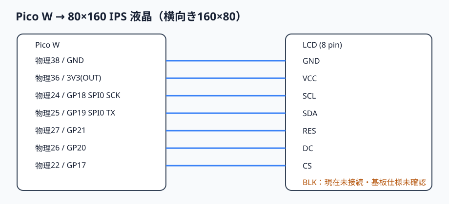

# Pico W ↔ 0.96インチ 80×160 IPS 液晶

| Pico W 物理ピン | GPIO/電源 | LCD端子 | 用途 |
|---:|---|---|---|
| 22 | GP17 | CS | SPI0 CS相当、ソフトウェア制御 |
| 24 | GP18 | SCL | SPI0 SCK |
| 25 | GP19 | SDA | SPI0 TX (MOSI) |
| 26 | GP20 | DC | コマンド/データ切替 |
| 27 | GP21 | RES | リセット |
| 36 | 3V3(OUT) | VCC | 3.3 V 電源 |
| 38 | GND | GND | グラウンド |
| — | — | BLK | **現在未接続・基板仕様未確認** |

SPI0 の SCK=GP18、TX=GP19 の組み合わせを使用します。GP17はSPI0のCSnにも対応しますが、このテストではコマンドとデータごとにGPIO出力として制御します。液晶は横向き160×80を想定します。

裏面写真の基板印字は `DRIVER IC: ST7735S` と確認されています。実画面の表示RAMオフセット・色順・回転は通電試験待ちです。BLKの完全な内部配線も写真では追えていません。[MSP0961の資料に基づく完成形の条件付き案](compact-layout.md)を参照してください。電源投入、配線変更、Picoへの書込みはこの作業に含みません。
