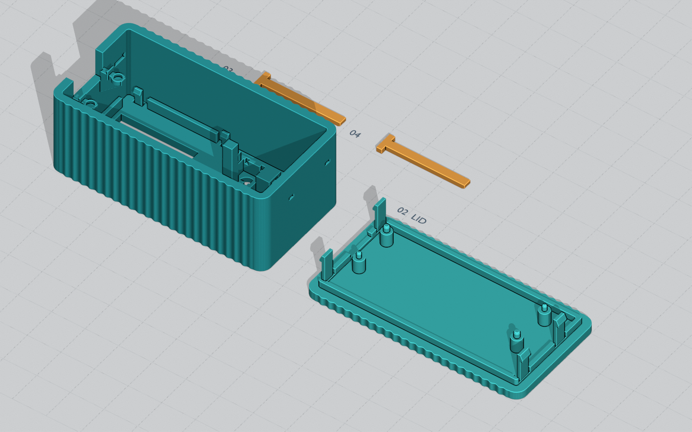
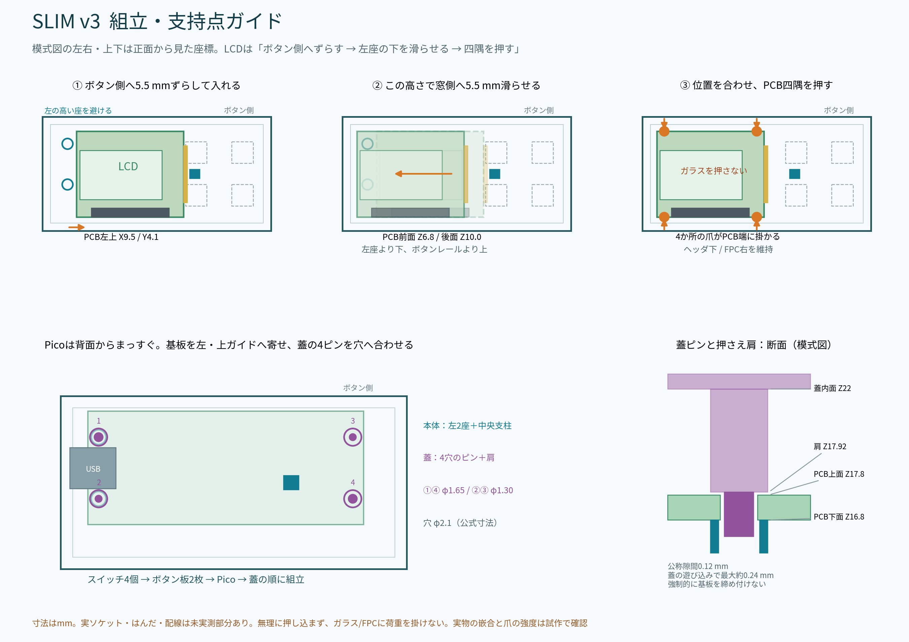

# 採用済みケース：YouTube LCD Case SLIM v3

Pico W、0.96インチLCD、4ボタンを収める最終v3です。ユーザーが印刷・組立し、ボタン保持板はきつめながら入ることを確認して、変更せず採用しました。今回の登録では形状・寸法・STL・生成スクリプトを変更していません。

画像はBlenderの設計レンダーです。実機写真ではありません。以下の原資料には制作時点の「実印刷未検証」という記述も残っています。上の組立結果はその後のユーザーによる使用個体の確認で、すべての材料・プリンターの嵌合を保証するものではありません。

## 印刷するファイル

**一括配置版を1つ、または個別4部品を読み込みます。両方を同時に読み込まないでください。**

| ファイル | 用途 |
|---|---|
| [00_all_parts_A1mini.stl](slim-v3/stl/00_all_parts_A1mini.stl) | 4部品の一括配置。140×56.6×24.4mm |
| [01_shell.stl](slim-v3/stl/01_shell.stl) | 本体。横64mm、縦最大32.7mm |
| [02_lid.stl](slim-v3/stl/02_lid.stl) | 蓋。Pico穴の位置決めピンと押さえ肩 |
| [03_button_row_1.stl](slim-v3/stl/03_button_row_1.stl) | 上段のボタン保持板 |
| [04_button_row_2.stl](slim-v3/stl/04_button_row_2.stl) | 下段のボタン保持板 |

mm、100%で読み込み、本体の横幅64mmを確認してください。一括配置はA1 miniの180mm角内に収まります。スライス済み3MF/G-code、サポート、ブリムは含みません。LCD保持爪は本体と一体で、別のLCD保持板05/06は不要です。

基本外形は64×32×26.8mm、波形を含む最大外形は約64×32.7×26.8mmです。個別STLは印刷方向へ配置済みで、本体は正面外側、蓋は平らな背面外側、保持板は広い平面をベッドへ向けます。細い爪の溝とオーバーハングをスライサーで確認します。材料・サポートの詳細は[STL原資料](slim-v3/stl/README_JA.md)にあります。

## 組立

1. 空の本体へLCDを先に入れる。最終位置よりボタン側へ5.5mmずらし、背面から下ろして窓側へ滑らせる。
2. 最終位置でPCB四隅を順に座らせ、本体一体の爪へ掛ける。ガラスとFPCを押さえない。
3. スイッチ4個を各ポケットへ入れ、上下のボタン保持板をLCD側からボタン側へ滑らせる。
4. 配線とソケット位置を確認し、Picoを背面から下ろす。USB口は左側。
5. 蓋の4ピンをPicoの穴へ合わせ、配線を挟まないよう閉じる。

詳しい高さ・経路は[Blender原資料](slim-v3/blender/README_JA.md)と[STL原資料](slim-v3/stl/README_JA.md)を参照してください。本体と蓋はv3同士を使います。保持板の嵌合については使用個体での組立結果を優先し、今回再設計していません。電子配線は[採用済みSPI0配線](../../README.md#配線)に合わせます。CAD内の参考配線は電気配線の確定図ではありません。

## 編集・設計資料

- [YouTube_LCD_Case_SLIM_Fit_v3.blend](slim-v3/blender/YouTube_LCD_Case_SLIM_Fit_v3.blend)：Blenderファイル。ファイルヘッダーは`BLENDER-v403`、モデルは1単位＝1mm。
- [build_youtube_case_v3.py](slim-v3/blender/build_youtube_case_v3.py)：モデル再生成ソース。
- [render_v3.py](slim-v3/blender/render_v3.py)、[make_assembly_guide.py](slim-v3/blender/make_assembly_guide.py)：画像生成。
- [validation.json](slim-v3/blender/validation.json)、[assembly_path_audit.json](slim-v3/blender/assembly_path_audit.json)：元の幾何・挿入経路の検査。
- [export_manifest.json](slim-v3/stl/export_manifest.json)、[stl_validation.json](slim-v3/stl/stl_validation.json)：元のSTL書出しと検査記録。
- [今回のファイル検証](../../docs/verification/case-v3-import-20261010.json)：実ファイルのSHA256、バイト一致、STL寸法・閉じた辺・巻き方向の確認。

01〜10の設計画像と計7本のスクリプトも同梱しています。元パッケージの相対配置を保持し、書出しスクリプト自体は変更していません。`stl/export_trial.py` のSOURCEは配布元の `youtube_case_draft_v3` 配置を想定するため、再生成するときは作業コピーでBlenderの場所を合わせてください。生成スクリプトはファイルを上書きするので、保存済みv3をそのまま印刷する場合は実行不要です。

## 取得元と保持方針

2026-10-10にChatGPT Libraryから、このraspi5へ以下の指定版を取得しました。

| 原パッケージ | Library ID | 版 |
|---|---|---:|
| YouTube_LCD_Case_SLIM_v3_Blender.zip | libfile_76d162b6c6c0819190151227abd5ddbc | 2 |
| YouTube_LCD_Case_SLIM_v3_Trial_STL.zip | libfile_73b84241e98081919f5d2cc9adc00b23 | 1 |

[SOURCE_MANIFEST.json](slim-v3/SOURCE_MANIFEST.json)に取得元・版・ZIPと展開後33ファイルのSHA256を保存しています。リポジトリには展開後のBlender/STL/画像/説明/スクリプトを登録し、ZIPを二重登録しません。ZIPは取得時の一時フォルダーに保持しました。v1/v2のケースは混在させていません。
